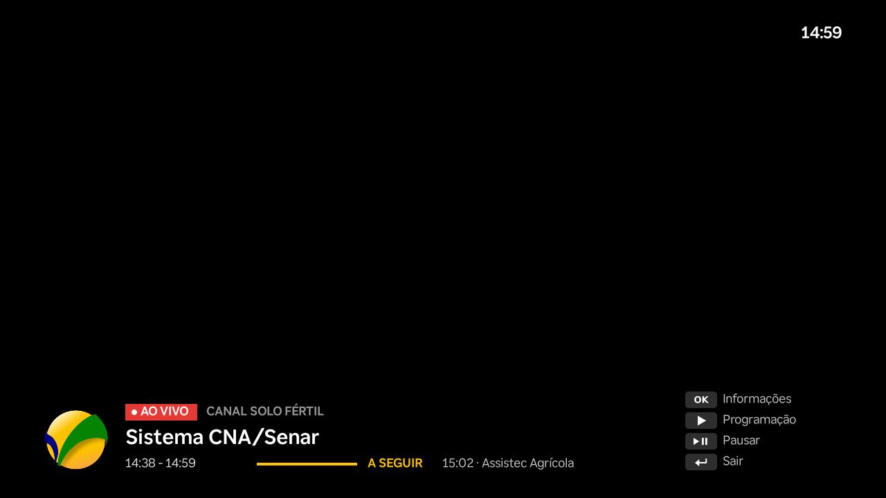
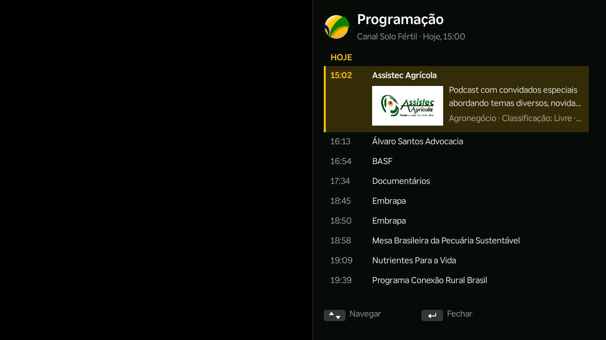
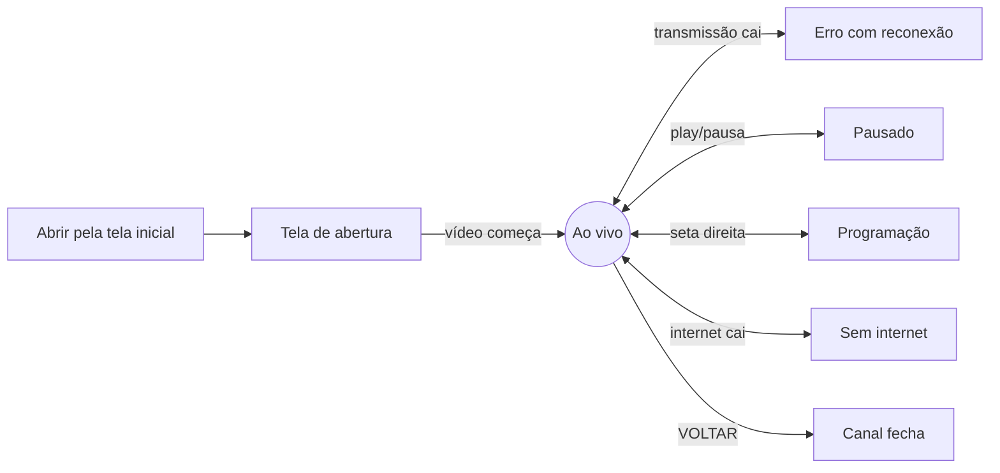

<p align="center">
  
</p>

<h1 align="center">Canal Solo Fértil — app para Roku</h1>

<p align="center"><em>Sempre ao lado de quem produz</em></p>

App do **Canal Solo Fértil** para Roku (BrightScript / SceneGraph). Ele abre direto na transmissão ao vivo, em tela cheia, e mostra o que está no ar e a programação dos próximos dias.



## Telas

| | |
|:---:|:---:|
|  |  |
| **Abertura** — aparece enquanto o app conecta na transmissão | **Programação** — próximos programas por dia, com imagem e descrição |

> As prints foram tiradas no Roku, em **Utilities → Screenshot**. O Roku não captura a camada de vídeo, por isso o fundo das telas "Ao vivo" e "Programação" aparece preto; no aparelho, a interface fica sobre a transmissão.

## O que o app faz

- Toca a transmissão HLS ao vivo em tela cheia
- Mostra o programa no ar, o horário, a barra de progresso e o próximo programa, lidos do EPG (XMLTV)
- Abre a grade de programação, com os programas separados por dia e o selecionado expandido (imagem, descrição, categoria e classificação)
- Exibe a barra de informações sozinha quando começa um novo programa
- Atualiza a programação a cada 30 minutos e guarda uma cópia para abrir mais rápido
- Reconecta sozinho se a transmissão cair (3, 5, 10, 20 e 30 s), com contagem na tela
- Avisa quando a internet cai e retoma a transmissão quando ela volta
- Pausa e continua; depois de 30 s pausado, volta para o ponto ao vivo
- Suporta Direct to Play (`contentId` / `mediaType`) e envia o sinal `AppLaunchComplete`
- Reinicia o player quando a Roku avisa que a memória está baixa (canal 24/7)
- Firmware mínimo **15.1**, interface em HD (1280x720)

## Controle remoto

| Tecla | Ação |
|---|---|
| OK | Mostrar/ocultar informações · tentar de novo na tela de erro · continuar após pausa · fechar a programação |
| ▶ (direita) ou `*` | Abrir a programação |
| ▲ / ▼ na programação | Navegar pelos programas (⏩ / ⏪ pulam de 5 em 5) |
| ◀ (esquerda), ▲, ▼ na tela ao vivo | Mostrar a barra de informações |
| ⏯ Play/Pausa | Pausar / continuar |
| VOLTAR | Fechar a programação · na tela principal, fecha o canal (padrão da Roku) |

## Estrutura do repositório

```
roku-canalsolofertil/
├── app/                    ← projeto Roku (é o conteúdo desta pasta que vai no zip)
│   ├── manifest            ← nome, versão, ícones e firmware do canal
│   ├── source/main.brs     ← entrada: roInput, memória e eventos
│   ├── components/
│   │   ├── MainScene.*     ← tela principal, vídeo, barra, reconexão e rede
│   │   ├── GuideView.*     ← painel lateral da programação
│   │   ├── GuideRow.*      ← linha da programação (dia, programa, selecionado)
│   │   ├── EpgTask.*       ← baixa e interpreta o XMLTV (com cache)
│   │   └── InputTask.*     ← recebe deep links (roInput)
│   └── images/             ← ícone (290x218), abertura (1280x720), logo e gradientes
├── loja/                   ← material para o Developer Dashboard da Roku
│   ├── icones/
│   └── capturas/
├── docs/prints/            ← imagens deste README
└── build.sh                ← gera out/canalsolofertil.zip
```

## Configuração

Tudo o que muda com frequência fica no início de `app/components/MainScene.brs`:

```brightscript
function getStreamUrl() as string
  return "https://stream.canalsolofertil.com.br/live/canalsolofertil/index.m3u8?cookieCheck=1"
end function

function getEpgUrl() as string
  return "https://stream.canalsolofertil.com.br/epg.xml"
end function

function getChannelName() as string
  return "Canal Solo Fértil"
end function
```

O `?cookieCheck=1` evita o redirecionamento do MediaMTX, já que o Roku não guarda cookies. O EPG deve cobrir sempre **hoje e os próximos dias**; sem programa para o horário atual, o app mostra só o nome do canal e a grade mostra "Programação indisponível no momento".

O app lê `title`, `desc`, `category`, `icon` e `rating/value` de cada `<programme>`, com horários no formato `20261013110000 -0300`.

## Gerar o pacote

```bash
./build.sh        # cria out/canalsolofertil.zip
```

O `manifest` precisa ficar **na raiz do zip**; por isso o script zipa de dentro de `app/`. No Windows (PowerShell), dentro de `app/`:

```powershell
tar -a -c -f ..\canalsolofertil.zip manifest source components images
```

## Instalar no Roku (modo desenvolvedor)

1. Ative o modo desenvolvedor: no controle, **Home ×3, Cima ×2, Direita, Esquerda, Direita, Esquerda, Direita**. Defina uma senha e anote o IP do Roku.
2. Gere o zip (`./build.sh`).
3. Abra `http://IP-DO-ROKU` no navegador (usuário `rokudev` e a senha definida), envie o zip em **Upload** e clique em **Install**. Para atualizar, use **Replace with zip**.
4. Console de depuração: `telnet IP-DO-ROKU 8085` (uma conexão por vez; no PuTTY use o tipo **Raw**).

> **Guarde a chave de desenvolvedor** (Dev ID e senha do `genkey`) fora do repositório. Toda atualização publicada precisa ser assinada com a mesma chave. O `.gitignore` já impede que `.pkg` e chaves sejam versionados.

## Publicação na loja Roku

A versão **1.4.00007** foi preparada para publicação no Developer Dashboard em 13/10/2026.

| Item no Developer Dashboard | Origem |
|---|---|
| **App package** (`.pkg` assinado, firmware mínimo **15.1**) | gerado pelo **Packager** do instalador |
| **Screenshots** (1280x720) | `loja/capturas/` |
| Ícone do canal (290x218) | `loja/icones/icone-290x218.png` (já está em `app/images/icon_hd.png`) |
| **Nota de lançamento** | texto abaixo |

Nota de lançamento usada:

```
Nova interface do Canal Solo Fértil: tela de abertura com a arte do canal, barra com o programa no ar, horário, progresso e o próximo programa, e grade de programação por dia (aperte a seta para a direita). Reconexão automática se a transmissão cair, aviso de falta de internet e pausa com retorno ao ao vivo. Melhorias de desempenho e estabilidade.
```

A cada nova versão: aumente `minor_version` / `build_version` em `app/manifest`, gere o `.pkg` com a mesma chave e envie em **App package**.

O app reproduz vídeo continuamente. Se a certificação apontar o item de protetor de tela, peça isenção à Roku em developer.roku.com/contact.

## Fluxo de telas



## Problemas comuns

- **"Install Failure: No manifest":** o `manifest` precisa estar na raiz do zip (sem pasta por fora). Use o `build.sh`.
- **Erro 401 / "session not found" na stream:** o MediaMTX prende a sessão ao IP do cliente. Deixe `hlsTrustedProxies` vazio se não houver proxy na frente e confira se o IP do Roku não muda entre as requisições.
- **"Console connection is already in use":** só há uma conexão por vez na porta 8085; feche as janelas antigas do telnet/PuTTY.
- **Screenshot sai preto:** o Roku não captura o vídeo, só a interface; abra a barra (OK) ou a programação antes de capturar.
- **Programação não aparece:** confira se o `epg.xml` abre no navegador e se tem programas para hoje.
- **Mudou o código e nada mudou no Roku:** envie o zip de novo com **Replace with zip** e aumente a versão se for publicar.

## Versão Samsung

Existe uma versão equivalente para TVs Samsung (Tizen): [samsung-canalsolofertil](https://github.com/LuizStSantos/samsung-canalsolofertil). Os dois apps usam a mesma transmissão e o mesmo guia.

---

Marca, logos e programação © Canal Solo Fértil.
